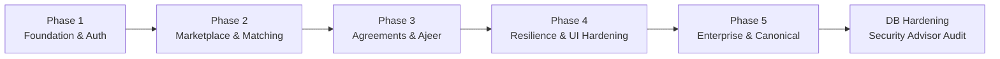
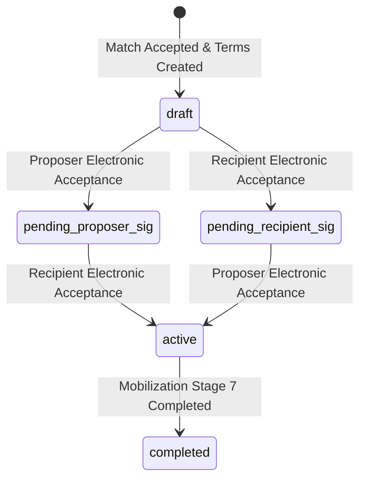
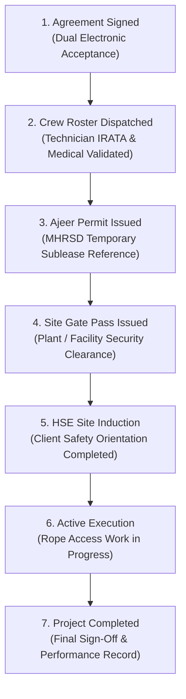

# 🇸🇦 RopeLink — Saudi Industrial & Rope Access B2B Marketplace

> **Enterprise Digital Infrastructure for Rapid Turnaround Mobilization, Certified Rope Access Crews, and Saudi Ajeer-Compliant Subleasing.**

[-black?style=flat&logo=next.js)](https://nextjs.org/)
[](https://react.dev/)
[](https://www.typescriptlang.org/)
[](https://supabase.com/)
[](https://tailwindcss.com/)
[](./scripts/)
[]()

---

## 📌 Table of Contents
1. [Executive Summary & Platform Mission](#-executive-summary--platform-mission)
2. [Tech Stack & Materials Used](#-tech-stack--materials-used)
3. [Separated Project Phases & Implementation History](#-separated-project-phases--implementation-history)
   - [Phase 1: Foundation, Multi-Tenant Auth & Design System](#phase-1-foundation-multi-tenant-auth--design-system)
   - [Phase 2: B2B Marketplace & 4-Factor Matching Engine](#phase-2-b2b-marketplace--4-factor-matching-engine)
   - [Phase 3: B2B Agreements, Realtime Chat & Ajeer Mobilization Pipeline](#phase-3-b2b-agreements-realtime-chat--ajeer-mobilization-pipeline)
   - [Phase 4: Resilience, UI Safeguards & Fault Isolation](#phase-4-resilience-ui-safeguards--fault-isolation)
   - [Phase 5: Enterprise Optimization, Canonical Matching & Accessibility](#phase-5-enterprise-optimization-canonical-matching--accessibility)
   - [Database Hardening & Security Advisor Remediation](#database-hardening--security-advisor-remediation)
4. [Core Architectural Workflows & State Machines](#-core-architectural-workflows--state-machines)
   - [1. Canonical Specialty Matching Engine](#1-canonical-specialty-matching-engine)
   - [2. Dual-Party Electronic Sublease Agreement](#2-dual-party-electronic-sublease-agreement)
   - [3. Sequential 7-Stage Saudi Ajeer Mobilization Pipeline](#3-sequential-7-stage-saudi-ajeer-mobilization-pipeline)
5. [Database Architecture & Security Model](#-database-architecture--security-model)
   - [Schema & Tables](#schema--tables)
   - [Row-Level Security (RLS) & Triggers](#row-level-security-rls--triggers)
   - [Isolated Directory View (`profile_directory`)](#isolated-directory-view-profile_directory)
6. [Bilingual Internationalization (Arabic & English)](#-bilingual-internationalization-arabic--english)
7. [Automated Verification & Quality Assurance](#-automated-verification--quality-assurance)
8. [Local Development & Setup Guide](#-local-development--setup-guide)
9. [Project Directory Layout & Architectural Rules](#-project-directory-layout--architectural-rules)

---

## 🚀 Executive Summary & Platform Mission

In Saudi Arabia's booming industrial landscape (Jubail, Yanbu, Ras Al-Khair, NEOM, and Western Province giga-projects), industrial contractors face a recurring paradox:
1. **Critical Turnaround Downtime:** During refinery, petrochemical, and power plant turnarounds, contractors urgently require hundreds of IRATA-certified rope access technicians, NDT inspectors, and high-altitude welders in under 48 hours. Traditional recruitment cycles take weeks and carry high regulatory hurdles.
2. **Idle Bench Capacity:** Between scheduled turnaround outages, specialized subcontracting firms pay certified crews to sit idle on payroll without active project revenue.
3. **Regulatory & Compliance Friction:** Cross-company manpower subleasing in the Kingdom requires strict alignment with the **Ministry of Human Resources and Social Development (MHRSD)** regulations, mandatory **Ajeer (أجير)** manpower subleasing permits, client site gate passes, and Aramco/SABIC HSE standards.

**RopeLink** provides the digital B2B infrastructure connecting certified rope access suppliers with engineering and industrial contractors to:
- Instantly monetize idle crew capacity through temporary enterprise subleasing.
- Mobilize pre-vetted IRATA Level 1/2/3 technicians with verified certifications.
- Execute dual electronic sublease agreements with immutable audit trails.
- Enforce a tamper-proof, trigger-guarded **7-Stage Mobilization State Machine** adhering strictly to Saudi Ajeer compliance protocols.

---

## 🛠️ Tech Stack & Materials Used

RopeLink is constructed on a modern, enterprise-grade full-stack architecture prioritizing performance, accessibility, multi-tenant isolation, and modularity:

### Frontend & Application Layer
| Technology | Version | Purpose & Usage |
| :--- | :--- | :--- |
| **Next.js** | `16.3.4` | App Router architecture, Turbopack compiler, static generation (SSG) with dynamic localization, server actions, dynamic imports. |
| **React** | `19.0.0` | Next-generation React concurrency model, hooks, and streaming hydration. |
| **TypeScript** | `5.7.3` | Strict type safety across database types, matching engine interfaces, and component props. |
| **Tailwind CSS** | `3.4.17` | Responsive utility-first design system customized with industrial dark theme palette (`#07090E`, `#0E1524`, amber-500 accent glow). |
| **next-intl** | `4.14.2` | Zero-compromise bilingual routing (`/ar` and `/en`), full Right-to-Left (RTL) / Left-to-Right (LTR) support, message dictionaries. |
| **Framer Motion** | `12.4.7` | Hardware-accelerated modal transitions, backdrop fades, drawer sliding, and interactive dashboard state animations. |
| **Lucide React** | `0.475.0` | Comprehensive iconography for industrial tools, status badges, and workflow milestones. |
| **Driver.js** | `1.3.1` | Localized interactive product tour guide (`GuidedTour.tsx`) for newly registered contractors and suppliers. |
| **Sonner** | `2.0.1` | High-performance toast notification stack with localized triggers and error recovery feedback. |
| **Zod** | `3.24.2` | Runtime data validation for form inputs, request models, and API boundaries. |

### Backend, Database & Real-Time Infrastructure
| Technology | Version | Purpose & Usage |
| :--- | :--- | :--- |
| **Supabase Cloud / CLI** | `v3.0.0` | Managed PostgreSQL host, migration engine, realtime channel replication, and client auth. |
| **PostgreSQL** | `17.6` | Relational storage engine with native ENUM types, custom search paths, indexes, and triggers. |
| **Supabase SSR** | `0.5.2` | Cookie-based session resolution for server components, route guards, and middleware. |
| **Supabase Realtime** | `v2.151.3` | WebSocket-based Postgres changes listener powering instant peer-to-peer chat and marketplace broadcasts. |
| **Supabase Storage** | `v1.17` | Multi-tenant isolated storage bucket (`verification-docs`) for Commercial Registration (CR) and HSE certificates. |
| **Docker** | Engine v27+ | Local Supabase emulation stack running PostgreSQL, PostgREST, Kong gateway, Mailpit, and Logflare. |

---

## 📈 Separated Project Phases & Implementation History

The RopeLink platform was architected and delivered across 5 rigorous developmental and hardening phases:



---

### Phase 1: Foundation, Multi-Tenant Auth & Design System
- **Next.js 16 App Router Setup**: Localized route structuring under `app/[locale]/` with full bi-directional switching (`/ar` and `/en`).
- **Industrial Design Tokens**: High-contrast dark theme optimized for field tablets and desktop control rooms. Custom Tailwind utility extensions (`shadow-amber-glow`, `glass-panel`).
- **Supabase Authentication**: Multi-tenant authentication layer supporting Contractor and Supplier profiles with session preservation via `@supabase/ssr`.
- **RBAC Foundation**: Role segregation (`contractor`, `supplier`, `admin`).
- **Interactive Onboarding**: Integrated `driver.js` walkthrough introducing users to the marketplace, posting requests, and proposal management.

---

### Phase 2: B2B Marketplace & 4-Factor Matching Engine
- **Request Publishing Engine**: Standardized schemas for:
  - `project` (Enterprise posting turnaround requirements).
  - `need_manpower` (Subcontractor seeking certified personnel).
  - `available_crew` (Supplier with bench technicians on standby).
- **Geographic Coverage**: Deep localization for Saudi industrial hubs: Jubail Industrial, Yanbu Industrial, NEOM, Riyadh, Dammam, Khobar, Ras Al-Khair, Tabuk, and Jazan.
- **Matching Engine Architecture**: Developed the core matching algorithm in `src/lib/matching/engine.ts` balancing 4 weighted factors:
  - **40% Specialty Match** (IRATA levels & industrial trade qualifications).
  - **30% Proximity Match** (Saudi industrial cluster distance matrix).
  - **20% Mobilization Timeline** (Mobilization buffer delta).
  - **10% Headcount Sufficiency** (Available crew vs. requested technician count).
- **Upstream Hard Eligibility Gate (`isEligibleMatch`)**: Filters out demand-vs-demand or supply-vs-supply pairings, zero headcounts, and invalid timeline dates.

---

### Phase 3: B2B Agreements, Realtime Chat & Ajeer Mobilization Pipeline
- **Realtime Negotiation Chat**: Secure WebSockets-backed chat room per accepted match proposal, enabling direct contractor-to-supplier communication.
- **Electronic Sublease Agreements (عقود الإسناد الميدانية)**:
  - Interactive terms specification: daily rate in SAR, technician counts, mobilization start and end dates.
  - Dual electronic signature tracking (`terms_accepted_proposer`, `terms_accepted_recipient`).
- **Saudi Ajeer Compliant 7-Stage Mobilization**:
  - Implemented the full sequential compliance state machine:
    1. `agreement_signed`
    2. `roster_dispatched`
    3. `ajeer_permit_issued`
    4. `gate_pass_issued`
    5. `hse_induction_done`
    6. `active_execution`
    7. `completed`
- **Crew Roster Management**: Database module tracking individual technicians dispatched under agreements, capturing IRATA license numbers, Ajeer permit references, and gate pass clearances.

---

### Phase 4: Resilience, UI Safeguards & Fault Isolation
- **H1 Trigger-Safe Signing Order**: In `useAgreements.ts`, restructured state transitions so `status === 'draft'` takes absolute precedence over signature flags, guaranteeing safe transition to `pending_proposer_sig` without DB trigger rejections.
- **H2 Input Preservation**: Guarded `CrewRosterModal.tsx` against network or schema insert drops by preserving user inputs upon database failure and surfacing localized toast errors.
- **H3 Chat Overflow Boundary**: Implemented a 500-character upper bound in `ChatInput.tsx` and `ChatModal.tsx` with dynamic counter badges (`{count}/500`) and red overflow warning banners.
- **H6 Global Fault Isolation**: Added route-level error boundary `src/app/[locale]/error.tsx` with one-click recovery.
- **U2 Skeleton Loading States**: Added animated skeleton placeholder loaders (`src/app/[locale]/dashboard/loading.tsx`).
- **Configuration Guard**: Added `ConfigurationGuard.tsx` to detect unconfigured Supabase environments and alert users when operating in mock/fallback mode.
- **U1 & U7 Feedback & Resets**: Added localized mobilization trigger feedback and automatic modal lifecycle state clears upon opening.

---

### Phase 5: Enterprise Optimization, Canonical Matching & Accessibility
- **U5 [CRITICAL] Canonical Specialty Matching**:
  - Engineered `toCanonicalSpecialtyId` helper in `src/lib/constants.ts` to normalize all trade entries across Arabic and English into stable canonical IDs (`irata_l1`, `irata_l2`, `irata_l3`, `ndt_inspection`, `industrial_welding`, `facade_maintenance`, `blade_repair`).
  - Upgraded matching engine to evaluate cross-language pairs with 100% precision.
  - Implemented IRATA hierarchical logic (Level 3 Supervisor satisfies Level 1/2 demands at 95%; Level 2 satisfies Level 1 demands at 85%).
  - Aligned `RequestForm.tsx` and `MarketplaceFilters.tsx` to persist canonical values.
- **H4 Realtime Chat Reconnect Recovery**: Added automatic missed message recovery on channel `SUBSCRIBED` events, `window.online`, and tab `visibilitychange` with state deduplication by message ID.
- **H5 Stale Data Reset**: Configured auth and data hooks to purge internal state and cache entries immediately on sign-out or session change, preventing cross-user data leakage.
- **U3 Dialog Accessibility**: Created `useModalA11y.ts` providing `Escape` key close dispatch, initial interactive element focus, and trapped `Tab` / `Shift+Tab` focus cycles.
- **U4 Mobile Viewport Height (`dvh`)**: Converted all application modals to `max-h-[88dvh] overflow-y-auto`, eliminating bottom clipping beneath mobile browser address bars.
- **P1 & P2 Marketplace Memoization & Pagination**: Wrapped filtering in `useMemo` and added incremental client pagination (`loadMore`).
- **P3 Dynamic Modal Code-Splitting**: Converted heavy modals in `dashboard/page.tsx` to `next/dynamic` (`ssr: false`), accelerating initial page hydration.
- **P4 Client Query Caching Layer**: Implemented memory-based cache `clientCache.ts` with TTL and stale-while-revalidate pattern, eliminating blank spinner flashes during tab navigation.

---

### Database Hardening & Security Advisor Remediation
Following automated audits by the Supabase Security and Performance Advisors, dedicated migrations were deployed to eliminate database vulnerabilities:
- **`0010_security_definer_view` Fixed**: Converted `profile_directory` to `WITH (security_invoker = true)` to ensure views respect the invoking client's permissions.
- **`0011_function_search_path_mutable` Fixed**: Set explicit `SET search_path = public, pg_temp` on all 5 privileged stored procedures, preventing search-path hijacking attacks.
- **`0028` & `0029` RPC Privilege Revoked**: Revoked `PUBLIC` execute rights on internal trigger functions; converted administrative checks to `SECURITY INVOKER`.
- **`0003_auth_rls_initplan` Fixed**: Wrapped `auth.uid()` and role lookups in scalar subqueries `(SELECT auth.uid())` across all RLS policies, allowing PostgreSQL query planner to cache execution plans.
- **`0001_unindexed_foreign_keys` Fixed**: Added covering B-tree indexes across all 9 unindexed foreign key constraints in `agreements`, `audit_logs`, `chat_messages`, `crew_rosters`, and `matches`.

---

## 🔄 Core Architectural Workflows & State Machines

### 1. Canonical Specialty Matching Engine

Complementary requests (Demand: `project` or `need_manpower` vs. Supply: `available_crew`) pass through a two-stage evaluation pipeline:

```mermaid
graph TD
    ReqA[Request A] & ReqB[Request B] --> Gate{isEligibleMatch?}
    Gate -- No (Same Type, 0 Count, Bad Date) --> Zero[Score = 0 | Ineligible]
    Gate -- Yes (Complementary Pair) --> Scoring[Weighted Multi-Factor Scoring]
    Scoring --> S1[Canonical Specialty: 40%]
    Scoring --> S2[Saudi City Proximity: 30%]
    Scoring --> S3[Timeline Proximity: 20%]
    Scoring --> S4[Headcount Sufficiency: 10%]
    S1 & S2 & S3 & S4 --> Aggregate[Final Match Score: 0 - 100%]
```

#### Factor Weighting Matrix
$$\text{Score} = (S_{\text{spec}} \times 0.40) + (S_{\text{loc}} \times 0.30) + (S_{\text{time}} \times 0.20) + (S_{\text{head}} \times 0.10)$$

- **Specialty Scoring ($S_{\text{spec}}$):**
  - Canonical Exact Match (`cDemand === cSupply`): **100%**
  - IRATA Hierarchy: Level 3 Supervisor supplying Level 1/2 demand: **95%**
  - IRATA Hierarchy: Level 2 Technician supplying Level 1 demand: **85%**
  - Under-credentialed pairings: **60% – 70%**
- **Geographic Scoring ($S_{\text{loc}}$):**
  - Same Saudi City: **100%**
  - Same Industrial Region (e.g. Jubail ↔ Dammam ↔ Khobar ↔ Ras Al-Khair): **85%**
  - Cross-Region Transit (e.g. Riyadh ↔ Dammam): **65%**
  - Distant Regions (e.g. NEOM ↔ Jazan): **40%**
- **Mobilization Buffer ($S_{\text{time}}$):**
  - Start dates $\le 2$ days apart: **100%**
  - Start dates $\le 7$ days apart: **80%**
  - Start dates $\le 14$ days apart: **55%**
  - Start dates $> 14$ days apart: **30%**

---

### 2. Dual-Party Electronic Sublease Agreement

Agreements are governed by database triggers preventing unilateral activation:



- **Trigger Guard (`trg_enforce_agreement_signature_rules`):** Proposers can only mutate `terms_accepted_proposer`; recipients can only mutate `terms_accepted_recipient`. Transition to `active` is rejected by PostgreSQL unless both parties have confirmed acceptance.

---

### 3. Sequential 7-Stage Saudi Ajeer Mobilization Pipeline

Once an agreement becomes `active`, the mobilization pipeline advances strictly in sequential order:



- **Trigger Guard (`trg_enforce_mobilization_sequence`):**
  - Transition from Stage 1 to Stage 2 requires `agreement.status = 'active'`.
  - Stages cannot be skipped (e.g., advancing directly from Stage 1 to Stage 4 throws a PostgreSQL exception).
  - Regressive transitions (moving backwards) are strictly prohibited.

---

## 🗄️ Database Architecture & Security Model

The database runs on PostgreSQL 17.6 with Row-Level Security (RLS) enabled across 100% of public tables.

### Schema & Tables

| Table Name | Primary Key | Description & Role |
| :--- | :--- | :--- |
| `public.profiles` | `id` (UUID references `auth.users`) | Enterprise company details, CR number, verification status, role (`contractor`, `supplier`, `admin`). |
| `public.requests` | `id` (UUID) | Demand and supply listings with city, start date, headcount, and canonical specialty. |
| `public.matches` | `id` (UUID) | B2B proposal bindings linking a proposer, a recipient, and a target manpower request. |
| `public.chat_messages`| `id` (UUID) | Realtime participant-scoped messages bound to a specific match. |
| `public.agreements` | `id` (UUID) | Sublease contracts tracking terms, dual electronic acceptances, daily rates, and milestone stage. |
| `public.crew_rosters` | `id` (UUID) | Deployed personnel roster bound to agreements, storing IRATA credentials and Ajeer permit references. |
| `public.audit_logs` | `id` (UUID) | Append-only audit trail capturing security and state transitions. Direct client writes rejected. |

---

### Row-Level Security (RLS) & Triggers

- **Immutable Audit Logging**: The `audit_logs` table has a strict `WITH CHECK (false)` policy for all authenticated and anonymous clients. Logs can only be written by trusted `SECURITY DEFINER` database triggers.
- **Privilege Escalation Protection (`trg_prevent_profile_privilege_escalation`)**: Blocks any non-administrator attempt to alter `profiles.role` or `profiles.verification_status`.
- **Sender Verification on Chat**: `chat_messages` insertion requires `WITH CHECK (auth.uid() = sender_id)` plus active match membership, completely preventing sender spoofing.
- **Storage Isolation**: Verification documents are isolated inside `verification-docs` under `auth.uid()/*`. Read access is restricted to the owning enterprise and administrators.

---

### Isolated Directory View (`profile_directory`)

To protect sensitive corporate data (e.g. CR numbers, tax registrations, internal phone records, HSE documents), cross-user joins do not query `public.profiles` directly. 

Instead, the secure view `public.profile_directory` exposes only public discovery fields:
```sql
CREATE VIEW public.profile_directory 
WITH (security_invoker = true) AS
SELECT 
    id,
    company_name,
    role,
    city,
    verification_status,
    has_seen_tutorial,
    created_at,
    updated_at
FROM public.profiles;
```

---

## 🌐 Bilingual Internationalization (Arabic & English)

RopeLink is architected from the ground up for the Saudi market with native bilingual parity:
- **Routing**: Language routing handled via `next-intl` under `/[locale]` (`/ar` and `/en`).
- **Typography & RTL Layout**: Directional styling adapts automatically based on locale (`dir="rtl"` for Arabic, `dir="ltr"` for English).
- **Synchronized Dictionaries**:
  - `src/messages/ar.json` (Saudi Arabic terminology: "اعتماد وتأكيد إلكتروني", "تصريح أجير للإسناد", "فني حبال IRATA").
  - `src/messages/en.json` (English terminology: "Electronic Agreement Acceptance", "Ajeer Sublease Permit", "IRATA Rope Access").
- **Strict Parity Enforcement**: Automated test `scripts/verify-phase2.mjs` verifies that every section and inner key exists in both dictionaries with identical structure.

---

## 🧪 Automated Verification & Quality Assurance

RopeLink includes a comprehensive 3-stage test harness:

```bash
npm test
```

### Test Suite Breakdown (66 / 66 Tests Passing ✅)

```text
========================================
🧪 [1] Phase 2 Verification Suite (12/12 Passed)
========================================
✅ I18N-01: AR and EN dictionary section parity
✅ I18N-02: All inner translation keys are 100% synchronized
✅ ARCH-01: Codebase Modularity: Every file in src/ is < 200 lines
✅ SEC-01 to SEC-05: Realtime & database integrity
✅ ENG-01 to ENG-04: Matching engine 40/30/20/10 factor weight verification

========================================
🧪 [2] Phase 3 Ajeer Compliance Suite (18/18 Passed)
========================================
✅ I18N-01 to I18N-05: Chat, agreements, and mobilization Ajeer copy parity
✅ ARCH-01: File size audit (< 200 lines rule)
✅ SEC-01 to SEC-09: Schema & realtime publications
✅ MILE-01 to MILE-03: 7-stage sequential milestone pipeline structure

=============================================================
🛡️  [3] Pilot Hardening & Live Supabase RLS Probes (36/36 Passed)
=============================================================
✅ STAT-01: Every file in src/ is strictly < 200 lines (Violations: 0)
✅ STAT-02: Session-derived authenticated chat sender ID resolution
✅ STAT-03 & STAT-04: Electronic acceptance terminology across AR & EN
✅ STAT-05: AgreementSignatureModal electronic acceptance verification
✅ STAT-06: Modal Accessibility Hook (Escape key & Tab focus trap)
✅ STAT-07: Client Query Cache (TTL, invalidation, session purge)
✅ SCH-01 to SCH-07: search_path security, trigger guards, RLS definitions
✅ RUN-01 to RUN-05: Matching runtime eligibility and 4-factor scoring
✅ RUN-05b: Cross-locale canonical specialty matching (AR vs EN = 100%)
✅ RUN-05c: Hierarchical IRATA matching (L3 Supervisor covers L1 at 95%)
✅ RUN-06 to RUN-09: Sequential mobilization state machine enforcement
✅ RUN-10 to RUN-12: Dual-party agreement acceptance verification
✅ RUN-13 to RUN-15: RBAC role escalation prevention
✅ RUN-16 to RUN-20: Live Supabase RLS & Storage probes (PostgreSQL 42501 checks)
```

---

## 💻 Local Development & Setup Guide

### 1. Prerequisites
- **Node.js**: `v20.x` or `v22.x`
- **Docker Desktop**: Running locally (for local Supabase emulation)
- **Supabase CLI**: Installed (`v3.0.0` or higher)

### 2. Clone & Install Dependencies
```bash
git clone https://github.com/MostafaMo426/RopeLink.git
cd RopeLink
npm install
```

### 3. Environment Configuration
Create a `.env.local` file in the project root:
```env
NEXT_PUBLIC_SUPABASE_URL=https://your-project-ref.supabase.co
NEXT_PUBLIC_SUPABASE_ANON_KEY=your-anon-key
SUPABASE_SERVICE_ROLE_KEY=your-service-role-key
```

### 4. Supabase Database Setup
To initialize the local Supabase container stack:
```bash
supabase start
supabase db reset
```

To link and verify against the remote production database:
```bash
supabase link --project-ref qffoupxfwgweuftztisz
supabase migration list --remote
```

### 5. Running Development Server
```bash
npm run dev
```
Open [http://localhost:3000](http://localhost:3000) in your browser. The app will automatically redirect to `http://localhost:3000/ar` or `http://localhost:3000/en`.

### 6. Production Compilation Check
```bash
npm run build
```

---

## 📂 Project Directory Layout & Architectural Rules

### Strict Modularity Constraint (`ARCH-01`)
> **Core Architectural Rule**: Every single TypeScript/TSX file located under `src/` must remain strictly **under 200 lines of code**. Large components must be decomposed into focused sub-components or custom hooks.

```text
RopeLink/
├── scripts/                          # Automated verification and audit test suites
│   ├── verify-phase1.mjs             # Phase 1 basic checks
│   ├── verify-phase2.mjs             # i18n & matching engine validation
│   ├── verify-phase3.mjs             # 7-stage Ajeer mobilization tests
│   └── verify-pilot-hardening.mjs    # Security, RBAC & live Supabase probes
├── src/
│   ├── app/                          # Next.js App Router localized structure
│   │   └── [locale]/
│   │       ├── dashboard/            # Authenticated enterprise dashboard
│   │       │   ├── loading.tsx       # Route skeleton loader
│   │       │   └── page.tsx          # Dynamic modal code-splitting view
│   │       ├── error.tsx             # Global fault isolation error boundary
│   │       ├── layout.tsx            # HTML layout, fonts & next-intl provider
│   │       └── page.tsx              # Public industrial landing page
│   ├── components/                   # Modular React UI components (< 200 lines each)
│   │   ├── agreements/               # Electronic agreement feeds & signing modals
│   │   ├── chat/                     # Realtime chat modal, input & message items
│   │   ├── common/                   # Configuration guard & layout utilities
│   │   ├── dashboard/                # Header, tabs, guided tour, proposal cards
│   │   ├── layout/                   # Navbar & Footer
│   │   ├── marketplace/              # Opportunity cards, filters, memoized feed
│   │   ├── mobilization/             # 7-stage tracker & crew roster modal
│   │   ├── requests/                 # Request creation modal & form
│   │   └── verification/             # Commercial Registration verification modal
│   ├── hooks/                        # Custom state, realtime & data hooks
│   │   ├── useAgreements.ts          # Agreement lifecycle & milestone transitions
│   │   ├── useMatchChat.ts           # Realtime chat with reconnect recovery
│   │   ├── useModalA11y.ts           # Dialog accessibility (Escape, focus trap)
│   │   ├── useRealtimeMarketplace.ts # Realtime requests & proposal subscriptions
│   │   ├── useRequests.ts            # User manpower requests management
│   │   └── useSupabaseAuth.ts        # Session resolution & profile synchronization
│   ├── i18n/                         # next-intl navigation & routing configuration
│   ├── lib/                          # Platform utilities, algorithms & constants
│   │   ├── cache/clientCache.ts      # Query cache with stale-while-revalidate
│   │   ├── constants.ts              # Canonical specialty taxonomy & Saudi cities
│   │   ├── matching/engine.ts        # 4-factor matching engine algorithm
│   │   └── supabase/client.ts        # Supabase browser & server client factories
│   ├── messages/                     # Bilingual translation dictionaries
│   │   ├── ar.json                   # Arabic localization dictionary
│   │   └── en.json                   # English localization dictionary
│   └── types/
│       └── database.ts               # Strict TypeScript database schema types
├── supabase/
│   ├── migrations/                   # Sequential immutable migration files (000 - 20261105)
│   └── schema.sql                    # Base schema reference & trigger functions
├── AUDIT.md                          # Pre-hardening vulnerability audit report
├── PILOT_HARDENING.md                # Platform hardening & pilot specification
└── ROADMAP.md                        # Master progress tracking roadmap
```

---

## 📄 License & Intellectual Property

Proprietary software. Designed and developed for Saudi industrial turnaround operations and Vision 2030 industrial mobilization compliance. All rights reserved.
